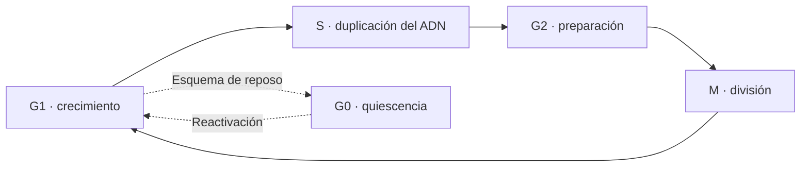
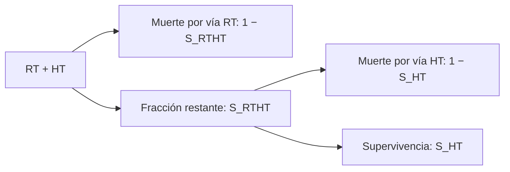

# A cellular automaton model for spheroid response to radiation and hyperthermia treatments

Brüningk et al. · *Scientific Reports* (2019)

**Tlacaelel Jaime Flores-Villaseñor**

Modelación

<div class="mt-6 text-sm opacity-70">Radiación, hipertermia y dinámica de crecimiento en esferoides tumorales</div>

<!--
Tiempo: 0:20. Presentar título, autor de la exposición y tema.
Fuente: artículo, p. 1. Duración objetivo del guion: 18:30, con 1:30 de margen hasta 20 min; preguntas: 5 min aparte.
-->

---

# Table of contents

<Toc text-sm minDepth="1" maxDepth="2" />

<!--
Tiempo: 0:20. Presentar brevemente el contenido de la exposición.
-->

---
class: text-center
---

# Resumen

Los esferoides tumorales tridimensionales permiten estudiar cómo el microambiente influye en la respuesta al tratamiento. Brüningk et al. proponen un autómata celular que simula el crecimiento de esferoides HCT116, la difusión de oxígeno y la respuesta a radiación e hipertermia. Aunque ambos tratamientos pueden producir una supervivencia clonogénica comparable, generan <span v-mark.underline.red="1">distintas dinámicas de crecimiento</span>. Para explicar esta diferencia, el modelo distingue la <span v-mark.underline.blue="2">muerte dependiente de la división tras radiación</span> de la muerte independiente de la proliferación tras calentamiento. Su comparación con datos experimentales muestra que considerar estos mecanismos permite reproducir la reducción y el recrecimiento del esferoide, incluso con tratamientos combinados.

<div class="source">Fuente: resumen e introducción, pp. 1–2; resultados y discusión, pp. 7–10.</div>

<!--
Tiempo: 0:50. El párrafo está visible completo desde el inicio. Usar dos avances para guiar la explicación con subrayados animados nativos de Slidev (v-mark).
[click] Destacar que supervivencias clonogénicas comparables pueden producir distintas dinámicas de crecimiento.
[click] Explicar la diferencia entre muerte ligada a división tras RT y muerte independiente de proliferación tras HT.
La supervivencia clonogénica mide la capacidad de seguir formando colonias. BEQD es una dosis biológicamente equivalente expresada en unidades de RT sola; una equivalencia basada solo en supervivencia clonogénica no describe toda la dinámica de reducción y recrecimiento.
No prometer que el estudio prueba eficacia clínica: trabaja con esferoides HCT116 in vitro.
Documentación de animaciones: https://sli.dev/guide/animations
-->

---

# La célula

### ¿Qué necesita representar este modelo?

<div class="grid grid-cols-3 gap-5 mt-7">
<div class="card"><b>Estado</b><p>Proliferando, en reposo o muerta.</p></div>
<div class="card"><b>Entorno</b><p>Oxígeno disponible y espacio entre vecinas.</p></div>
<div class="card"><b>Respuesta</b><p>Supervivencia y tiempo hasta la muerte tras el tratamiento.</p></div>
</div>

<div class="takeaway">Una célula biológica se representa como un agente con reglas simples.</div>

<div class="source">Fuente: modelo computacional, pp. 2–4. Esquema conceptual de la exposición.</div>

<!--
Tiempo: 0:40. Usar esta slide como puente a la modelación, sin desarrollar organelos.
El artículo no es una fuente de biología celular general: aquí se resume únicamente qué propiedades conserva el modelo.
-->

---
level: 2
---

# Ciclo celular



- Cada célula tiene un **reloj individual** y una fase inicial aleatoria.
- Sin espacio para dividirse, entra en **G0 reversible**.
- La muerte inducida por radiación se ejecuta al **intentar dividirse**.

<div class="source">Fuente: modelo computacional y respuesta a radiación, pp. 2–3. Diagrama didáctico.</div>

<!--
Tiempo: 0:55. Las etiquetas de las fases son contexto básico, no una investigación adicional de biología molecular.
El diagrama simplifica el ciclo: el artículo ubica la entrada a G0 cuando no hay espacio al intentar la división; no interpretar la flecha didáctica desde G1 como una regla exacta del algoritmo.
El oxígeno y el espacio afectan la progresión y supervivencia; reposo no significa muerte.
-->

---
level: 2
---

# Apoptosis y muerte celular

### Para leer este artículo, importa distinguir el destino de la célula

| Proceso considerado | Papel en la presentación |
|---|---|
| Apoptosis | Contexto de muerte celular; no es una vía explícita del autómata. |
| Muerte mitótica tras RT | Se produce cuando la célula dañada intenta dividirse. |
| Muerte tras HT | Se implementa con un retraso independiente de la proliferación. |
| Muerte por hipoxia prolongada | Contribuye al núcleo necrótico del esferoide. |

<div class="takeaway">El modelo describe reglas de muerte; no resuelve las vías moleculares.</div>

<div class="source">Fuente: métodos, pp. 2–4; discusión, p. 9.</div>

<!--
Tiempo: 0:40. Conservar el tema solicitado sin presentar apoptosis como explicación universal.
Pendiente para una ampliación futura: definición y animación de apoptosis respaldadas por una fuente específica. El artículo cita trabajos sobre apoptosis, pero no estudia sus vías moleculares.
-->

---

# Cáncer: el problema que se quiere representar

- El estudio usa **HCT116**, una línea celular de carcinoma colorrectal humano.
- Las células forman un agregado 3D con condiciones diferentes entre **periferia y centro**.
- Oxígeno, proliferación y tratamiento interactúan: la respuesta del conjunto no se deduce solo de una célula aislada.

<div class="takeaway">La pregunta se centra en la heterogeneidad dentro de un modelo tumoral.</div>

<div class="source">Fuente: introducción y datos experimentales, pp. 1–2.</div>

<!--
Tiempo: 0:40. Vincular el contexto de cáncer con la heterogeneidad que motiva el modelo.
No atribuir al artículo una revisión general de qué es cáncer. Queda pendiente una fuente externa para ampliar genética, transformación maligna o epidemiología si se decide incluirlas.
-->

---
level: 2
---

# Hipoxia y necrosis


<div class="grid grid-cols-3 gap-3 text-sm mt-3">
<div><b class="text-green-600">Verde:</b> hipoxia · pimonidazol</div>
<div><b class="text-red-500">Rojo:</b> proliferación · Ki-67</div>
<div><b class="text-blue-500">Azul:</b> núcleos · DAPI</div>
</div>

**Hipoxia ≠ necrosis.** Al día 4, cuando se trata, no hay hipoxia significativa; aparece después.

<div class="source">Figura 4, p. 7, Brüningk et al. (2019), CC BY 4.0. Recorte del PDF original.</div>

<!--
Tiempo: 1:00. Hipoxia: bajo oxígeno; necrosis: tejido/células muertas. No identificar toda señal verde como muerte.
El pie original sugiere necrosis por menor densidad celular central al día 25; no afirma que la tinción de hipoxia por sí sola pruebe necrosis.
La falta de hipoxia significativa en el día de tratamiento limita la calibración del efecto OER.
-->

---
level: 2
---

# Radioterapia e hipertermia

| | Radioterapia · RT | Hipertermia · HT |
|---|---|---|
| Intervención | Radiación ionizante | Elevación de temperatura |
| Dosis del estudio | 0–10 Gy | 0–240 CEM43 |
| Implementación de la muerte | Dependiente de la división | Independiente de la proliferación |
| Efecto espacial modelado | Reducción desde la periferia | Eliminación también en zonas quiescentes |

**CEM43:** minutos equivalentes acumulados a 43 °C.

En los experimentos se calentó a **47 °C**; la dosis equivalente permite expresar duración y temperatura.

<div class="source">Fuente: resumen, datos experimentales y métodos, pp. 1–4; figura 6, p. 8.</div>

<!--
Tiempo: 0:55. Gy es unidad de dosis absorbida. CEM43 no son grados Celsius ni duración real salvo a 43 °C.
Ejemplo del propio artículo: 47 °C durante 2.5, 5 y 15 min corresponden a 40, 80 y 240 CEM43.
El calor puede radiosensibilizar; esta tabla describe reglas del modelo, no recomendaciones terapéuticas.
-->

---

# Esferoides tumorales (*tumour spheroids*)

### Un modelo experimental entre el cultivo 2D y el tumor in vivo

- Agregados celulares **tridimensionales y avasculares**.
- Generan gradientes de oxígeno y contacto entre células.
- Permiten medir el **diámetro a lo largo del tiempo** después del tratamiento.

**Experimento:** 300 células HCT116 sembradas → formación del esferoide → tratamiento al día 4 → seguimiento durante 3 semanas.

<div class="takeaway">Se busca predecir reducción, retraso del crecimiento y recrecimiento.</div>

<div class="source">Fuente: introducción y datos experimentales, pp. 1–2.</div>

<!--
Tiempo: 0:40. Las 300 células son el número sembrado, no el número de células al tratar ni el tamaño inicial exacto de la simulación.
Retomar BEQD de la slide Resumen: supervivencia clonogénica y evolución del diámetro son observables diferentes.
No llamar al esferoide tumor vascularizado ni organoide.
-->

---

# Modelo: un autómata celular 3D

<div class="grid grid-cols-2 gap-7">
<div>

### Representación

- Una célula por vóxel de **12 μm** de lado.
- Malla típica: **200 × 200 × 200** vóxeles.
- Estado, reloj y destino para cada célula.
- Vecindarios Moore y von Neumann hasta segundo orden.

</div>
<div>

### Reglas locales

1. Actualizar el oxígeno.
2. Avanzar ciclo y comprobar espacio.
3. Dividirse o entrar en G0.
4. Aplicar muerte y eliminación según el estado.
5. Reacomodar para conservar un agregado compacto.

</div>
</div>

<div class="source">Fuente: modelo computacional y oxigenación, pp. 2–3. Secuencia conceptual resumida.</div>

<!--
Tiempo: 1:20. La malla tiene 8 millones de posiciones; no todas están ocupadas. El resumen menciona simulaciones de 10^4–10^7 células.
En división se favorecen sitios centrales. No hay migración celular explícita; el reacomodo geométrico no equivale a modelar motilidad.
Las reglas discretas celulares se acoplan a un campo continuo de oxígeno: modelo híbrido.
-->

---
level: 2
---

# Oxígeno: difusión y consumo

$$
\frac{\partial p_{O_2}(\mathbf{x},t)}{\partial t}
= D_{O_2}\nabla^2p_{O_2}(\mathbf{x},t)-\Phi(\mathbf{x})
$$

- **Difusión:** transporta oxígeno hacia el interior.
- **Consumo:** $\Phi=0$ en vóxeles vacíos; hay consumo donde hay células.
- Condición exterior: **100 mmHg**; umbral de hipoxia: **11 mmHg**.
- Se calcula el equilibrio de oxígeno en cada iteración del ciclo celular.

<div class="takeaway">El entorno determina qué células proliferan y cuáles pueden morir por hipoxia.</div>

<div class="source">Fuente: ecuación 1 y oxigenación, pp. 2–3; calibración, p. 6.</div>

<!--
Tiempo: 1:25. p es presión parcial; D es coeficiente de difusión y Phi es tasa de consumo.
Difusión en segundos frente a ciclo en horas justifica el equilibrio cuasiestacionario (cambio máximo ≤0.01%).
D ajustado: 3.8 × 10^-9 m²/s; consumo usado: 22.1 mmHg/s.
La muerte por hipoxia y eliminación de células necróticas son probabilísticas. El término hipoxia agrupa simplificadamente otros efectos del microambiente.
-->

---
level: 2
---

# Dos tratamientos, dos dinámicas de muerte

$$
S_{\mathrm{RT}}=\exp\!\left[-\gamma\left(\alpha d_{\mathrm{OER}}+\beta d_{\mathrm{OER}}^2\right)\right],
\qquad d_{\mathrm{OER}}=\frac{d}{\mathrm{OER}(p_{O_2})}
$$

| Radiación | Calor |
|---|---|
| Supervivencia: modelo lineal-cuadrático | Supervivencia: modelo AlphaR ajustado a 3D |
| Célula marcada para morir: espera a dividirse | Célula marcada: espera un retraso aleatorio |
| G0 puede conservar células dañadas en el centro | La muerte también libera espacio en el centro |
| Contracción gradual | Reoxigenación y posible repoblación |

<div class="source">Fuente: ecuaciones 2–5 y figura 1, pp. 3–4.</div>

<!--
Tiempo: 1:30. No desarrollar todas las ecuaciones. alpha y beta dependen de la línea celular; gamma pondera fase del ciclo; OER corrige por oxigenación.
OER=1 si pO2>11 mmHg; OER=3−2pO2/(11 mmHg) si pO2≤11 mmHg. Es una hipótesis del modelo, no un ajuste validado aquí en hipoxia.
RT: las células destinadas a morir aún pueden dividirse; las hijas conservan la marca. Probabilidad mitótica: 0.44 los primeros 3.5 días y 0.59 después.
HT: retraso medio de muerte 96 h, eliminación inmediata después de morir; supervivientes con arresto medio de ciclo 30 h. «Rápida» es relativa a muerte mitótica, no instantánea.
AlphaR tiene tramo cuadrático y después lineal; la supervivencia 3D se fija en una meseta para dosis mayores de 160 CEM43 (meseta ajustada 0.0005). No se modela dependencia directa de la letalidad térmica con oxígeno ni pH.
-->

---
level: 2
---

# Combinación RT + HT

$$
S_{\mathrm{combinada}}(d,t_{43})
= S_{\mathrm{RTHT}}(d,t_{43})\,S_{\mathrm{HT}}(t_{43})
$$



**La radiosensibilización entra en $\alpha$ y $\beta$, que dependen de la dosis térmica.**

<div class="source">Fuente: figura 2 y combinación de tratamientos, p. 5.</div>

<!--
Tiempo: 1:05. Las fracciones de las dos últimas ramas son condicionales a la población restante.
S_RTHT es el componente radiativo modificado por calor; no es la supervivencia total combinada. El producto no representa simplemente dos tratamientos independientes: la sinergia entra mediante alpha y beta dependientes del calor.
La prioridad de asignación a vía RT o HT forma parte de la cascada implementada. No afirmar que el estudio optimiza el orden ni el fraccionamiento: son desarrollos futuros.
-->

---

# Calibración y validación

| Etapa | Datos para ajustar | Comprobación posterior |
|---|---|---|
| Oxígeno y crecimiento | Modelo analítico + esferoides sin tratar | Histología y curvas de crecimiento |
| RT | **10 Gy** | 2 y 5 Gy |
| HT | **240 CEM43** | 40 y 80 CEM43 |
| RT + HT | Sin nuevos ajustes | 2 Gy + 40, 80 y 160 CEM43 |

- Ajuste por búsqueda en rejilla, un parámetro a la vez.
- Comparación entre curvas mediante **$R^2$**.

<div class="source">Fuente: ajuste y validación, pp. 5–6.</div>

<!--
Tiempo: 0:55. Separar calibrar de validar: no todas las curvas son predicciones independientes.
Oxígeno se compara cuantitativamente con el modelo de Grimes y cualitativamente con histología.
El crecimiento sin tratar también se calibra. No llamar validación independiente al R² del control ajustado.
Los autores advierten que los parámetros pertenecen a un sistema simplificado: no interpretarlos como mediciones biológicas directas.
-->

---

# Resultados: crecimiento sin tratamiento


- Curva calibrada: **$R^2=0.99$**; tiempo de duplicación ajustado: **28 h**.
- Coincidencia cualitativa de la región central muerta.
- Oxígeno simulado frente al analítico: diferencias de hasta **15 %**.

<div class="source">Figura 5, p. 7, recortada; comparación de oxígeno: figura 3, p. 6. Brüningk et al. (2019), CC BY 4.0.</div>

<!--
Tiempo: 1:00. A: diámetro vs tiempo; B: microscopía con células muertas en naranja; C: simulación.
El 15% corresponde al campo de presión de oxígeno, no al error del diámetro ni a un R².
La meseta de crecimiento se representa mediante muerte hipóxica y eliminación de células necróticas, aunque en esta ventana aún se observa crecimiento.
-->

---

# Resultados: RT y HT por separado


<div class="text-sm mt-1">Arriba: RT · R² = 0.95–0.98. Abajo: HT · R² = 0.94–0.98.</div>
<div class="source">Figura 6, p. 8, recorte de filas RT y HT. Brüningk et al. (2019), CC BY 4.0. Eje x compartido: días desde la siembra.</div>

<!--
Tiempo: 1:30. Eje vertical: diámetro en micrómetros; horizontal: días desde siembra, no desde tratamiento. Puntos: datos; rojo: simulación; discontinuas: incertidumbre de supervivencia clonogénica donde aplica. Las barras son error estándar de al menos tres experimentos.
Primera columna: calibración con 10 Gy y 240 CEM43; restantes: validación.
RT 10 Gy: reducción sin recrecimiento observado en tres semanas. HT 240 CEM43: reducción y posterior recrecimiento. No presentar estas dos dosis como una pareja cuantitativamente isoefectiva demostrada por esta figura.
R² RT: 10 Gy 0.98, 5 Gy 0.95, 2 Gy 0.98. HT: 240 0.95, 80 0.94, 40 0.98.
Limitación visible: subestima diámetro temprano para 40 y 80 CEM43; posible aflojamiento de estructura o matriz no modelados.
-->

---

# Resultados: tratamiento combinado


| Dosis | 2 Gy + 160 CEM43 | 2 Gy + 80 CEM43 | 2 Gy + 40 CEM43 |
|---|---:|---:|---:|
| $R^2$ | 0.86 | 0.88 | 0.96 |

**Curvas simuladas sin volver a ajustar los parámetros.**

<div class="source">Figura 6, p. 8, recorte de fila RTHT. Brüningk et al. (2019), CC BY 4.0.</div>

<!--
Tiempo: 1:15. Leer de izquierda a derecha para conservar orden visual original.
Se predice tanto retraso del recrecimiento como reducción persistente durante la ventana observada.
Todos los tratamientos logran R²>0.85, pero no hay validación clínica ni optimización de dosis para pacientes.
-->

---

# Conclusiones

1. **La supervivencia clonogénica sola no describe la dinámica** del esferoide.
2. Acoplar **reglas celulares, espacio y oxígeno** reproduce las curvas estudiadas.
3. RT y HT calibradas por separado permiten simular la **combinación sin reajustes**.

### Alcance y límites

Una línea celular *in vitro*; geometría simplificada; sin vasculatura, inmunidad ni pH/glucosa explícitos. Falta validar el efecto de hipoxia sobre RT.

<div class="takeaway">El siguiente paso es ampliar y validar el modelo para condiciones in vivo.</div>

<div class="source">Fuente: discusión y conclusiones, pp. 9–10.</div>

<!--
Tiempo: 1:10. Responder la pregunta inicial. No usar R² como prueba de que el mecanismo sea único o molecularmente demostrado.
Limitación específica: esferoides bien oxigenados al día 4 impidieron ajustar OER; haría falta tratar esferoides con centro hipóxico no necrótico.
El objetivo futuro es explorar fraccionamiento y programación, no un resultado ya obtenido.
Si falta tiempo, conservar estas tres conclusiones y omitir los detalles numéricos de los resultados.
-->

---

# Referencias

**Fuente principal revisada**

Brüningk, S. C., Ziegenhein, P., Rivens, I., Oelfke, U. & ter Haar, G. (2019). *A cellular automaton model for spheroid response to radiation and hyperthermia treatments*. **Scientific Reports, 9**, 17674. [doi:10.1038/s41598-019-54117-x](https://doi.org/10.1038/s41598-019-54117-x).

Figuras 4–6: recortes del artículo original, [licencia CC BY 4.0](https://creativecommons.org/licenses/by/4.0/). Sin cambios en los datos.

<div class="mt-8 text-xl">Preguntas · 5 min</div>

<div class="text-sm opacity-70 mt-4">Fuentes de contexto por ampliar: biología celular, apoptosis y definición general de cáncer.</div>

<!--
Tiempo: 0:20. Cerrar en 18:30 y dar paso a preguntas; el margen restante hasta 20 min permite pausas y transiciones.
Solo el artículo original se ha revisado como fuente en esta versión. Las referencias que este cita no se presentan como leídas.
Las diapositivas posteriores están ocultas: son ejemplos conservados de la plantilla de Slidev.
-->


---
hide: true
---

# Monaco Editor

Slidev provides built-in Monaco Editor support.

Add `{monaco}` to the code block to turn it into an editor:

```ts {monaco}
import { ref } from 'vue'
import { emptyArray } from './external'

const arr = ref(emptyArray(10))
```

Use `{monaco-run}` to create an editor that can execute the code directly in the slide:

```ts {monaco-run}
import { version } from 'vue'
import { emptyArray, sayHello } from './external'

sayHello()
console.log(`vue ${version}`)
console.log(emptyArray<number>(10).reduce(fib => [...fib, fib.at(-1)! + fib.at(-2)!], [1, 1]))
```

---
hide: true
layout: center
class: text-center
---

# Learn More

[Documentation](https://sli.dev) · [GitHub](https://github.com/slidevjs/slidev) · [Showcases](https://sli.dev/resources/showcases)

<PoweredBySlidev mt-10 />
